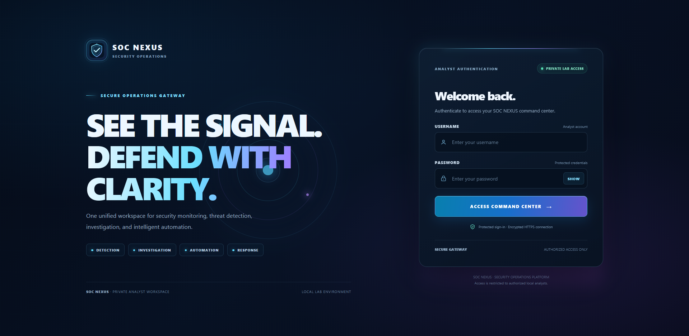

# SOC NEXUS

### Unified SOC Automation Center

**One Environment. Connected Security. One Unified Mission.**

SOC NEXUS is an evolving, self-developed Security Operations and Automation Center designed to bring multiple cybersecurity technologies into one centralized, analyst-focused workspace.

## Technology Stack

| Technology | Purpose |
|---|---|
| Splunk Enterprise | Security monitoring and detection visibility |
| n8n | Workflow automation and execution monitoring |
| MISP | Threat intelligence and IOC enrichment |
| TheHive | Incident and case management |

## Project Capabilities

The supplied project documentation describes:

- Centralized security operations overview.
- System health monitoring.
- Detection analytics and incident exploration.
- Investigation and evidence visibility.
- Automation history and response pipeline.
- Authenticated analyst dashboard.
- HTTPS secure gateway.
- Configurable audio notifications and quiet hours.
- NEXUS ONE / ORBIT interface.

These are documented project capabilities, not an independent security audit.

## Architecture

The logical architecture brings together Splunk, n8n, MISP, and TheHive through the SOC NEXUS analyst workspace.

See [Architecture Documentation](docs/ARCHITECTURE.md).

## Dashboard Screenshots

Explore the SOC NEXUS interface through these 17 original screenshots.

<table>
<tbody>
<tr><td align='center'><strong>Dashboard 1</strong> </td><td align='center'><strong>Dashboard 2</strong> </td></tr>
<tr><td align='center'><strong>Dashboard 3</strong> </td><td align='center'><strong>Dashboard 4</strong> </td></tr>
<tr><td align='center'><strong>Dashboard 5</strong> </td><td align='center'><strong>Dashboard 6</strong> </td></tr>
<tr><td align='center'><strong>Dashboard 7</strong> </td><td align='center'><strong>Dashboard 8</strong> </td></tr>
<tr><td align='center'><strong>Dashboard 9</strong> </td><td align='center'><strong>Dashboard 10</strong> </td></tr>
<tr><td align='center'><strong>Dashboard 11</strong> </td><td align='center'><strong>Dashboard 12</strong> </td></tr>
<tr><td align='center'><strong>Dashboard 13</strong> </td><td align='center'><strong>Dashboard 14</strong> </td></tr>
<tr><td align='center'><strong>Dashboard 15</strong> </td><td align='center'><strong>Dashboard 16</strong> </td></tr>
<tr><td align='center'><strong>Login</strong> </td><td></td></tr>
</tbody>
</table>

## Security

Read [SECURITY.md](SECURITY.md) before using or sharing this repository.

Never publish API keys, passwords, authentication tokens, private certificates, session cookies, or sensitive configuration files.

## Repository Scope

**Current release: Documentation and Visual Showcase**

This repository currently contains project documentation, branding assets, and dashboard screenshots.

It does not contain the actual SOC NEXUS application source code, runtime dependencies, or installation package.

The working application remains in its original Debian environment. This repository is not currently an installable application.

## Project Status

SOC NEXUS is an evolving engineering and learning project. Its monitoring, integrations, interface, and security capabilities continue to be improved.

## Acknowledgements

Special thanks to IT Gate Academy for the learning foundation and to Nader Elgezawy for support and guidance.

---

**SOC NEXUS — Built, tested, improved, and continuously evolving.**